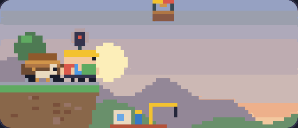

# loadbearing

A loading bar built by a tiny bridge crew.

Every beam they lay is real progress. When your progress stalls, they sit down
for a coffee. At 100% the train crosses the bridge.

**[Try the live demo](https://rostyslavdzhohola.github.io/loadbearing/)**



[Watch the video with sound](media/loadbearing.mp4)

One file, no dependencies, no build step, no image or audio assets. The scene
is flat vector art drawn on a canvas at whatever size you give it, and the sound
is synthesized with WebAudio.

## Use it

Copy [`loadbearing.js`](loadbearing.js) into your project.

```html
<script type="module" src="loadbearing.js"></script>

<load-bearing id="bar" style="width: 600px"></load-bearing>

<script type="module">
  const bar = document.getElementById('bar');

  // Feed it your real progress, 0..1, whenever it changes.
  upload.onprogress = (e) => (bar.progress = e.loaded / e.total);

  bar.addEventListener('arrived', () => showTheApp());
</script>
```

The crew works toward whatever you last set, speeding up when they fall behind,
so the bar never shows more than you have told it.

### Attributes

| Attribute  | What it does                                                    |
| ---------- | --------------------------------------------------------------- |
| `progress` | Target progress, `0`..`1`. Also a property: `bar.progress = 0.4` |
| `demo`     | Plays a fake download with a stall in the middle, on a loop     |
| `once`     | With `demo`: play once, don't loop                              |
| `seed`     | Seed for the random details (birds, fireworks)                  |
| `manual`   | Don't animate; you call `bar.loader.step(dt)` and `.draw()`     |

### Events

| Event      | When                                                    |
| ---------- | ------------------------------------------------------- |
| `progress` | A piece was placed. `event.detail.percent` is `0`..`100` |
| `stall`    | The crew ran out of work and sat down                   |
| `resume`   | Work came back                                          |
| `done`     | The bridge is finished (100%)                           |
| `arrived`  | The train has crossed. A good moment to move on          |

### Sound

Off until you ask for it, because browsers only start audio from a user gesture:

```js
button.onclick = () => bar.enableSound();   // bar.enableSound(false) to mute
```

Each beam plays the next note of a slowly rising tune, so a fast connection
sounds different from a slow one.

### Styling

The element is a 4:1 pill that scales to its width. Two CSS variables:

```css
load-bearing {
  --lb-frame: linear-gradient(#3a4257, #161b28); /* the bezel */
  --lb-frame-width: 2.4%;
}
```

### Things to tap

The crew, the dog, the water, the balloon and the sky all react.

## How it was made

Claude Fable 5.2 built this in a single Claude Code session, from one prompt
plus one round of feedback on the art style:
the simulation, the artwork, the sound synth, the demo page, the promo video
and this README. Session total: **about 9 million tokens and about $10** at API
list prices. Most of those tokens are cached context being re-read on each
step; the model wrote roughly 120,000 of them.

That figure comes from [`tools/session-cost.mjs`](tools/session-cost.mjs), which
sums the usage recorded in a Claude Code session transcript:

```sh
node tools/session-cost.mjs ~/.claude/projects/<project>/<session-id>.jsonl
```

The promo video is captured from [`video/video.html`](video/video.html), frame
by frame in headless Chrome, with the soundtrack rendered offline from the same
event log:

```sh
cd video && npm install && node render.mjs out/loadbearing.mp4
```

## Credit

Inspired by [@noclipepe's loading bar](https://x.com/noclipepe/status/2119881447687569842),
where tiny pixel-art workers build the bar brick by brick. This one has its own
scene, art style and code.

## License

MIT
